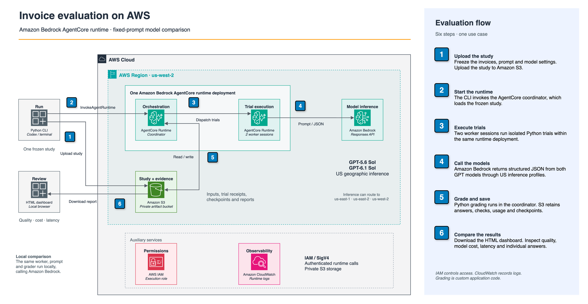

# Customer Eval

A Codex plugin for one initial use case: **invoice extraction from OCR text**.
Keep the prompt fixed, compare two models locally or on Amazon Bedrock
AgentCore, and inspect quality, model cost and latency in an HTML dashboard.

The plugin starts with a conversation about what correctness means. It does
not assume that matching an old model, passing synthetic examples or spending
less money is enough to justify a model change.

## Install

Add this repository as a Codex marketplace:

```bash
codex plugin marketplace add openai-on-aws/benchmarks-openai --ref feature/customer-eval-plugin
```

The feature branch selector is needed until the plugin is merged. If this
marketplace is already configured from `main`, test the feature branch in a
separate checkout and add its absolute root as a local marketplace instead.
After merge, use the repository's default branch.

In Codex's plugin directory, select **OpenAI on AWS**, install **Customer Eval**,
then use **Evaluate Invoices** in a new chat:

> Show the recorded invoice comparison and AWS architecture. Then help me
> challenge what the next study should measure.

The package contains a portable Agent Plugins manifest and a supported Codex
compatibility manifest. The repository marketplace exposes it alongside
Bedrock Bench. Pushing this branch does not publish it to the universal plugin
directory.

## First look: an interactive recorded report

From a repository checkout, with Python 3.12:

```bash
python3 plugins/customer-eval/scripts/invoice_eval.py demo --output invoice-demo
```

Open `invoice-demo/index.html`. No dependencies, credentials, deployment or
fresh model calls are needed. Backend filters, invoice selection, request
receipts, cost/latency charts and the AWS diagram work in a local browser.

This is the **recorded 13 November 2026 live comparison**, using synthetic,
unreviewed invoice references. Each backend completed 96 evaluation trials
and two route checks. The model-cost estimate was $0.71 combined, excluding
infrastructure. Both models matched every synthetic reference; this is weak
evidence for quality differences on harder invoices. See the
[recorded evidence](examples/recorded-invoice-comparison/).

## Run your own study

For the live workflow, use Python 3.12 on macOS or Linux in a workspace environment outside the installed plugin:

```bash
python3.12 -m venv .invoice-venv
.invoice-venv/bin/python -m pip install -r plugins/customer-eval/requirements.txt

.invoice-venv/bin/python plugins/customer-eval/scripts/invoice_eval.py start \
  --project invoice-results/my-study
.invoice-venv/bin/python plugins/customer-eval/scripts/invoice_eval.py inspect \
  --project invoice-results/my-study --input /absolute/path/to/invoices.jsonl
```

In Codex, continue the conversation to choose the two models, expected answers
and important fields. The skill writes small decision updates and prepares the
study. A [connection template](connection.template.json) records your routes,
profile references and verified prices. Credentials stay outside the package.

The common entrypoint supports `start`, `inspect`, `configure`, `prepare`,
`plan`, `run`, `status` and `results`. Start defaults to **no prompt
optimization** and does not require an optimizer model.

After preparing and reviewing the inputs:

```bash
# Both commands make real model calls using the same prepared study.
.invoice-venv/bin/python plugins/customer-eval/scripts/invoice_eval.py run \
  --project invoice-results/my-study --backend local --live
.invoice-venv/bin/python plugins/customer-eval/scripts/invoice_eval.py run \
  --project invoice-results/my-study --backend agentcore --live

# Inspect the existing cloud job; do not submit another job to view results.
.invoice-venv/bin/python plugins/customer-eval/scripts/invoice_eval.py status \
  --project invoice-results/my-study
.invoice-venv/bin/python plugins/customer-eval/scripts/invoice_eval.py results \
  --project invoice-results/my-study
```

AgentCore needs your own matching runtime, execution role and private S3
bucket. Installing the plugin does not create these resources. Follow
[AWS setup](docs/LIVE-SETUP.md) for an authorized deployment; deployed code
must match the engine fingerprint. Use `--backend local` with `results` for
the local report.

New studies produce `local/decision.html` and `results/decision.html`, one
dashboard per backend. The combined dashboard is currently the bundled
historical example. The [workflow reference](skills/evaluate-invoices/references/workflow.md)
documents preparation and execution settings.

## AWS architecture



One AgentCore deployment runs the coordinator and two worker sessions.
Amazon Bedrock provides inference; private S3 stores the frozen study and run
evidence; IAM controls access and CloudWatch records logs. The numbered
[editable diagram and step descriptions](docs/invoice-evaluation-flow.md)
show the path to the local report.

## Scope and limitations

- The evaluator receives OCR **text** and recorded conversation history. It
  does not extract text from PDFs or execute a customer's application tools.
- Deterministic checks measure the specified fields or the whole JSON object.
  Synthetic or historical-output agreement is not established production accuracy.
- Repeated attempts are not independent invoices. Sequential local/cloud runs
  do not measure a controlled hosting-overhead effect.
- Costs use returned usage and configured prices. Infrastructure and human
  review costs are separate; missing usage stays unknown.
- The bundled engine retains broader Codex, Strands, Gateway and optimization
  capabilities for compatibility. They are not needed by this first use case.

## Development

```text
customer-eval/
├── plugin.json                 Portable identity
├── .codex-plugin/plugin.json   Codex presentation and skill discovery
├── skills/evaluate-invoices/   One public workflow
├── scripts/invoice_eval.py     One entrypoint for both execution backends
├── engine/                    Bundled evaluator and AWS runtime
├── examples/                  Recorded interactive invoice report
├── docs/                      Deployment and editable AWS architecture
└── tests/                     Installed-package and workflow checks
```

Install `requirements-test.txt` in an isolated environment, then run:

```bash
python -m unittest discover -s plugins/customer-eval/tests -v
python -m pytest -q plugins/customer-eval/engine/tests \
  plugins/customer-eval/engine/intake/tests
```

Tests use local fixtures and loopback protocol servers, with no live model
calls or AWS deployments. Package tests copy the plugin to an isolated cache
and invoke it from another directory.

The plugin is [MIT-0](LICENSE), with an included MIT-0 importer.
[Upstream provenance](UPSTREAM.md) records the source and integration changes.
