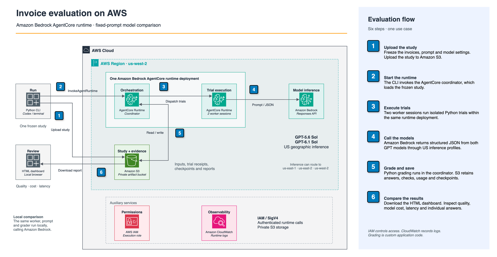

# Invoice evaluation on AWS

[Open the editable diagram in draw.io](https://app.diagrams.net/#create=%7B%22type%22%3A%20%22xml%22%2C%20%22compressed%22%3A%20true%2C%20%22data%22%3A%20%227Z1bc%2BI4Fsc%2FDY9QvgOPgUB3b3XvZDuZndmnlLAVUMVYjCSHpD%2F96mbjG4khabCDu2e6QLaFLz%2F9dXykc9Szpz17%2FrwOe5bxBAlFOOrZ1z1raA4M%2Fi8vhZGPAxQtVXHMHvojscGe9%2BxZz7jq2dP18wMKId91hSmTu1mzEPqM8Losq1CxZY0H3sAUG9TxliH%2Bs6cBAksC1vxLBNZQ7fstesLIF1XDJxDGgIlaLEP%2Bc%2FXXraodBWpnpHbugy0t1p78xvr5CwGb1Q8cQHHBwbM60hwahqoreFEl46RgSZLqdcEGLGGp4C8UsFWxLrHhK0TLFSvUuQbJzrqArkCAt5mi8rknV0AwZns37y5zCsMwc2v07%2FSs%2BeHHmsnVEBix91fHEBOsSCz4Iz3kQVP2Eur9H3DE5mCNQvG8vsLwCTLkg549YfCZn%2BRkxTjR9rXJP25XiMHbDfDFoVv%2B%2BHkZ5Ww%2BwikOMeGFEY74tgmHOCwUgRAtBbYhfBC1co7Fz4RXuniNgiCUh%2FLTuUW%2FxC%2FYRvJdn62pvydVh4KIfgDIY8%2FiLcnmf%2Bf8LlpT%2FnluzZ05LxzzY9Kmwy9p75MwX6OlxD7Ea8jIC%2F8OqDp%2BmRaJmvXvOPr56rZguerrNgO5mbC8ygDuWPW54PtoNA4miMaLaoiu1uCXJGYCA4L9R8HOEoo7TwRZJI4YWotPvanVmwhte0DPMOhvCF5vmGiYWhd8%2Fh0QRBP9agV4plcAz2g7eEOrJni2cRLwJHV9ElegV58TrvUbKJ%2BGfNB5IMSTmI9FR5FsSXoWq0kPxjSrJMGpeDLmSR4M7%2FH7fojjoCwJou8wprtthzyi9fNSWAsDXr0zWBIcixa8JN98acqUt97zj%2FfqPN4Ugmybr26YxrVqmrtvY31c0sBBzHAVQrph51t%2FtrwoJwxvyppD%2BQlzs%2B%2B7%2FJbp1rTaOBXdHL8xDHCuif6%2BwShikMyeOJ1UK5KPwxBsKFqkGnU%2BrK1hgWvPKHE9NiuwTm283ww2gUuUGtFFqn%2FqjbvuLKb9LaSsb52AdX1qOdBfg9qYDifD6wTq3be6UBvGlXPllaFOywNAVzCoINHYQ%2BLvagXn49k2CpabUdbpkVtlubkn4lmZYP0FjiOOxkuJ7D8iYZ%2FVNuQCuAnxy1rc1drEE%2FHbEhSjPr1z%2BWc8VvSaQ47CxPMOoNe8Go2uS726eRyGprUruhO7X4%2BOtPWyLFtHKvoZeXeLbypl%2FXZGVWbJ%2BDS8g%2FgZhagK9KvdFoNC8sRffukHM6xfJfIsFsEYDcfela3AmLhTZzpTYOTU9EMQ9d5A1LU805voMxlNh9zkrUS0XUh6ozKSw0okvdMgKXtvbi2jVDQzVP6Mow%2BAsMrerUaoUsNe06NXNdoVf7XR7NnXzri%2BPmv4qvT5GFltmyFc9PiMy9CaVhW01mmg3YPrzQtbSTth%2Bv1bz%2FJCIUMLwj8tmbydqgQlBVMc8BurTtYy%2BPNYowiEyW68FO0OfZf9TCDFMfGhsp4n%2FGulHQ05IMi%2FB5tNyCtjypymj5D5K00EjpnwE0xxFEGfJT6dTBsoo5tzJYg%2Fmcb3HSxgeIMpUr91vcCM4fWbAu9DAe%2FbbTwU1adNZ2cb6%2FYszh3QjboQ6Xn7nQ6qos59uNB7uSZjV1keFYb26IQiL%2FrwBQak7Bb5CZ8Q3HZS30m9azRM6vdD%2B%2FXux3fxzrfb4U3F%2F459IfDGguAtt7I7qf%2FEUp8D5wLV3seYBNygYfwGl9wqxF9BDo0eV22r7M8MzoaZ9cF8iAfmEmTfHjXdxH8F36zz72fi%2FKth7mdqPJPwL5QD8x6IK%2FDFFRwh%2BwV0O9l%2FRfYuUPi3mDxCQkut5o4gafzAZ%2BjHnfBfqPB7TRf%2BffgeJ%2FryymSN0rFOxbxD2sn%2Fp5X%2FDD0XKP2LZHy00HaSCa4oeoD8jvmwk%2F4LlP5x06V%2FH77l8f83df8npBuu9GIQ1bi6%2BXZuxe90%2FoN1PoPKBeo8tUtt5JbFwYs8biJnzaOg5To%2FmrszPb%2FGcuypiD2pq%2FP2fORZTufbaapPvwLfVOJv7RrqfkPQE2DiTQBwEB%2BAL2brL2KfS%2BzZlJ5f1BEiX0C1E%2FmyzF2gviMR91ac3CDmJyTvr60dqJ3PJjMNhTO2JrZZX9Wvr23HmXaqnkTDmA1T9Spo1cz0b1c%2Faoj6bOeXNAgO4dmUXJhODLGXexAF98D3IaX3axCBJZQzi49Q%2BQK6ncpXiN0FynyIl2U%2F5x8LMf8XLFDIEWyx0k9nzmyqld61RvYB9vtsaLrDSeeib6rSV3KbWvAyuu4vIBSyhp8mjd1QlZ5J8mWU3lac8711jMAXiO0EvkrmLkrh1UzTfoQZ3BPV9EDwLxhJtqXr5ryR5SlftWLLrQNjy%2FcFc5wx1jOvsY5VobHe%2BWLLCdxgsgef%2F8RA2Qa7SE9fZFrJfA8Bg5HfQXViqMxCsI9wWhahGp0PKpnPglZDlfbVSb%2F75eau7w484ZLD2aCIRbEvL%2FfuuTpkcp%2F6dfwpXhj5zZWdM%2FKPG7RsAs1O69NvjJO0DolGOmWcrarw4ZF7mi6WoD0wf9shY%2FhAORRi6S%2FmLxwl5GLah4CyvlmInZeF1jsD6puAotl6YR0beRTdishey3PPZu1RhglYwn00bmL%2Boilup8H0JDwCfYg2urQIpL%2BC%2FqN8SxXD1yAK5AHCIKBtSkBktx47d1TAziknUEiThmSxc0%2BEHfRjwk3Bml269MPqcMdbtPyvU69LvorZSnhEfW5UBrl8C5yAkJYP2A3PidE8QzeOz4xu8zrvUSGXzdCuQNepUEzPO5EPiT%2BDmtwmYVvZPGx1wL1bCQYpkKwms0CFCicZ3ooHKKnlpmcg54sSEf5uyDPljFYqNd8icmGWc5QM2oR7%2B9%2B87KLLtIJ2o4J20zzNq1e8CTFIco5Jh2Q5kp0BsoQsP0UCBkl60X13sh5jop7k6XI7YoWXOALhbFe6fwDh9YQhvEuceI5GYbhDoeC6H7jiJKLgihCZ2XQRqllxvGiOwuSn4DNif2c%2B%2F0%2BczWCojuWP%2FG99dvKL2mi5mrsPI4rAEDD0BA%2BkNfkFfoUgW3lixx1Sy%2B5sb8TRGa%2BVnTdIbLe2Wh9Vv1s%2Fh2epqagbUe%2BxyJaVPpnf3g770kte6nj%2B1I0065GtEDNfjQSARVjM%2FLtrmrn2XrN9ypGBfNt73%2FveodaKvCsT4D8upRgUOpbf3chSCPvGoOB56CsMDwFwh3ZyAvjhgUJ2GM4nJJNy%2BWf1O4hSfGTXU%2BjO4Kw9xQk8DRyTPfolsmY%2FQhkolY6rvkPDskR2EnaQhBXyiI4%2BvXoFiG7UkH9JwIpClVWxXLBfp2AXoWAJKntE7DolSTlL6bs0rMBlJ2PvkLH%2BBehYcbAxI2Q5rcqKWC5srRMxY%2FCahn0KCUsp2aNhN8kKEsrX%2Fq%2FbP%2F79LhU7Ygi8k7FLljEx5AIPtMUu0%2BUoX3KKu8jCN2VulNM58%2FQ61xi3pOsV3JKe%2BaFuyWL9rut8LrekbK97OpOfUPokVVeyJYi9961%2BJw1dP%2FKefsTxPn0%2FQrKJYTMdSdJXZPuPQqbOyzSEjVdGrgo9xPBTmMKKkH3v8ngb6SEVNX%2FpXcpFDsxS3ElXRroGdj73yyUMqMBN3ywxaR4TUye5IX52vkTddY6M4XSSrHKkP9eKgwvgA4jldJPyym%2FpAqHi15choLRi0kY2%2BKgYuXdcG%2FDOO7l%2BWDAyRxVzPCoCfqxTTQHluFkl3KwOt5biVsyW1UDcynlU7A63duLmFmbeNBE3p4Sb0%2BHWTtxGTgG3cfNwc0u4uR1uLVW3cSHc1mkebl4JN6%2FDrZ242QVXnVux6t4ZcQvhEkZBf5F6Bd6xfvhRy5fOruf8gSvSbMO1PbsmaRm3xZms8qIX1ioLiVMZk2q7p3y2cm340mOdic960RXjIcTbFgWJWJUZgFoVE2VabjEzZgkee1wVn%2B%2Bckh0aL6rxuUXPkha4odmoZCzTicRUReTRVgXaOe3P%2BVCEajSqB5V1Wqg6b%2BjHmjhSDxuEnelU5D%2Bq0rKT2jgBpD5BG9HlVdBXivRMI3CYCt1UcTiH5B6hGxDlgPb%2BiTFTGd4ECOIiclSSJa9V2IdT%2Fb9KOm2ocssVy0pm%2Fh0nepPUm5zAnED4C6anjqInrBbxzgac6mD%2BtV6PgULGULSkA%2F65%2BtJlwgojkx15kLkd6loPTZPWPtFvoCVhFxJSmBXh1bY9LDe%2FsXVy1e8GJT6v6luO03DVt95W%2FVsVaKSVj%2BQXd2q47KscA3LBcan5j3LJEXUl2SWrclMvxQ9x0ZVBDkL1d4fkkwJ2Yt9Isef2fGPFvhsS%2FLxibzujhou9%2FbbYqzTvMBPe1Q6d3%2BLqpQR1lhhEcajzI928sJW01pML5M%2BLrVC0s%2B1VRppdHqUAcuP%2FRWSX7xS%2FkYpvO3ZjFb8blf%2B8iu%2B4VsMV33lb8adAVqK0T%2BWgbYnolxceNAhkMZG6z5mNff5Far4K8RPm%2B1osRYWZMO2%2F3NxlrpjfAN7almKDTHKbCeoT%2FiHeWiDt5L%2BR8l%2BV%2BbYp8t%2FNkvm88u8m6b0aK%2F9ujUTiIp1i6vqm4Kktrp3UjhcJIVWWR26yUyndaX%2BW8esMkoSnvI8AKFK5e%2BlW5gwQvy%2FT%2BurPMZUZUfVNyST87XqARvYArms2tgfoJq593h7A85o%2BquvVeAGQeXt3Y6MEUv7U2%2FISkAliVKf%2F9e7Hd%2BG0SeJdhe5%2Fi9SiSpbxT7I6yzQz0KvWZ5lmV2bR0o%2BiAD2hIJYJjnV30fUBjewDPLeRY7wPGLNX82ijfP53sRwewfKNVC1uOSgs2iYWJ%2BBGDdWLsg3KbfJLahAhsZcfUybfe8FmE4o08WqCo8%2FhH7xvSbcuNfZv6FOGw5oz1NwP5VjuQ7DQ1tIeSViwWPTnh9TM7D5ya4AAt8PXeoM%2BQDhNeMn%2FAQ%3D%3D%22%7D)

[Open the full-size image](invoice-evaluation-flow.drawio.png). The PNG embeds the editable draw.io source.

The AWS reference architecture layout shows the deployed services, an AWS Cloud boundary, the us-west-2 deployment Region and six numbered connections. The coordinator and worker sessions share one AgentCore runtime deployment. Study inputs and run evidence share one private S3 bucket.

1. **Upload the study.** Freeze the invoices, prompt and model settings, then upload the study to S3.
2. **Start the runtime.** The Python CLI invokes the AgentCore coordinator using IAM / SigV4; the coordinator loads the study.
3. **Execute trials.** Two worker sessions execute trials in isolated Python subprocesses within the same runtime deployment.
4. **Call the models.** Workers invoke GPT-5.6 Sol and GPT-6.1 Sol through Amazon Bedrock's Responses API and US geographic inference profiles.
5. **Grade and save.** Custom Python grading runs in the coordinator. S3 preserves answers, checks, token usage, trial receipts, checkpoints and reports.
6. **Compare the results.** Download the HTML dashboard to compare reference agreement, model cost and latency, then inspect individual answers.

IAM supplies the scoped execution role and CloudWatch records runtime logs. The diagram summarizes the main flow; worker receipts also go to the shared S3 bucket. Grading is application code, not the managed AgentCore Evaluations service. US inference can route to us-east-1, us-east-2 and us-west-2.

The local comparison uses the same prompt, worker and grader on the local machine and calls the same Bedrock model routes. Its output is combined with the downloaded cloud report in the local dashboard.

XML structure, service icon names, edge references and geometry passed validation. The exported image was visually checked for label and badge overlap.

See [verified run results](../examples/recorded-invoice-comparison/README.md).
