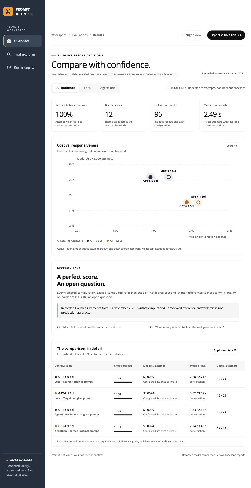

# Prompt Optimizer

Compare two models on a customer workflow with **one fixed prompt**, then
inspect quality, model cost and latency in an HTML dashboard. Start with
invoice extraction or support-ticket triage. Run the evaluator on your laptop
or in Amazon Bedrock AgentCore using the same prepared study.

Codex guides the setup and asks what the evidence needs to prove. You choose
which errors matter, what a correct answer looks like and whether the result
justifies a model change.


**One reusable evaluation workflow.** Prepare your inputs and fixed prompt,
run the study locally or on AgentCore, then explore the saved evidence in a
browser. The cloud path above applies to any supported structured-output
workflow. [Open the editable AWS diagram and six numbered steps](docs/prompt-optimizer-architecture.md).

| Start here | What you get | What you need |
| --- | --- | --- |
| **Explore the invoice demo** | Interactive results from a recorded local and AgentCore run, plus an AWS architecture diagram | Python; no credentials or new model calls |
| **Prepare a starter** | Inputs, expected answers, a request preview and a reproducible study plan | Python 3.12 and plugin dependencies; no live AWS calls during preparation |
| **Run locally** | Fresh model answers and a decision dashboard | Model access, verified prices and authorization for model calls; no AgentCore deployment |
| **Run on AgentCore** | Cloud coordinator and workers, durable artifacts and a downloaded dashboard | Model access plus a matching AgentCore runtime, IAM role and private S3 bucket |

## 1. Install in Codex

This plugin is currently on the feature branch. Add its marketplace and install it:

```bash
codex plugin marketplace add openai-on-aws/benchmarks-openai --ref feature/customer-eval-plugin
codex plugin add prompt-optimizer@openai-on-aws
```

You can also install **Prompt Optimizer** from **OpenAI on AWS** in Codex's plugin
directory. Open a new chat and choose **Evaluate Workflows**.

The [new-session quickstart](docs/QUICKSTART.md) includes refresh commands,
copyable prompts and a terminal-only demo.

If `openai-on-aws` is already registered from `main`, Codex rejects a second
source with the same marketplace name. Switch the registration, then install:

```bash
codex plugin marketplace remove openai-on-aws
codex plugin marketplace add openai-on-aws/benchmarks-openai --ref feature/customer-eval-plugin
codex plugin add prompt-optimizer@openai-on-aws
```

This changes the marketplace source; existing installed plugin caches and
settings are separate. Once registered on this branch, refresh its catalog
with `codex plugin marketplace upgrade openai-on-aws`, then install the
current Prompt Optimizer version. After merge, the default branch can be used.
This repository marketplace is separate from the universal plugin directory.

<details>
<summary>Updating a preview installed under the former name</summary>

Refresh the catalog and install the renamed plugin:

```bash
codex plugin marketplace upgrade openai-on-aws
codex plugin add prompt-optimizer@openai-on-aws
```

After Prompt Optimizer works in a new chat, remove the old cached preview with
`codex plugin remove customer-eval@openai-on-aws`. Your study directories and
reports remain in your workspace, outside the plugin cache.

</details>

## 2. Choose a starter

| Use case | Example decision | Included material |
| --- | --- | --- |
| **[Invoice extraction](examples/recorded-invoice-comparison/)** | Can a different model extract invoice fields at acceptable quality, cost and latency? | Recorded interactive comparison, per-case answers, cost/latency charts, AWS diagram; reusable OCR-text logs in `engine/examples/log-replay/logs/` |
| **[Support-ticket triage](examples/support-ticket-triage/)** | Can a model assign the right category, priority, queue and human-review flag? | 60 synthetic tickets, a fixed triage policy, expected JSON answers and a decision template; no recorded live results |

For the quickest first look, ask Codex:

> Use Prompt Optimizer to open the recorded invoice comparison and AWS diagram.
> Explain what the results establish, and ask me which errors would matter in
> my own workflow.

To prepare the new example, ask:

> Use Prompt Optimizer to start the support-ticket triage example. Show me the
> policy and ambiguous cases, and help me challenge the expected answers.
> Prepare a local study first; stop before paid model calls.

Both starters use the same skill and entrypoint. The triage example evaluates
routing **decisions**; it does not create tickets or call a support platform.
The invoice example starts with OCR **text**; it does not extract text from PDFs.

## 3. Agree what the study should measure

The skill inspects your records, explains exclusions and preserves the chosen
prompt. It asks for decisions in small steps:

- Which two model routes should be compared, and who owns the study?
- Which fields determine success? Should a wrong priority count differently
  from an unnecessary human review?
- Are the expected answers independently reviewed, synthetic, or historical
  model outputs? What evidence would change your mind about them?
- How many distinct cases and repetitions are useful? What cost and latency
  tradeoffs would justify switching models?

The default keeps the prompt fixed and needs **two models only**. It does not
require a third optimizer model. Synthetic labels remain marked unreviewed;
matching them is not proof of production accuracy.

## 4. Choose local, AgentCore, or both

**The workflow asks about infrastructure only if you choose AgentCore.** Before
freezing the study, it establishes whether you already have a matching runtime
and bucket, or want help creating them in your chosen AWS account and Region.

| Resource | Purpose | When needed |
| --- | --- | --- |
| Amazon Bedrock model access and credential references | Invoke the selected models | Fresh local and cloud runs using Bedrock |
| AgentCore Runtime | Host the coordinator and worker sessions | Cloud runs |
| Scoped IAM execution role | Give the runtime access to models, artifacts and worker invocation | Cloud runs |
| Private S3 artifact bucket | Store frozen inputs, checkpoints and reports | Cloud runs |
| CloudWatch Logs | Inspect runtime execution logs | Cloud runs |

Installing the plugin, opening a demo and preparing a draft do **not** deploy
resources. The `run` command also does not provision missing infrastructure.
The skill guides the separate [AgentCore setup](docs/LIVE-SETUP.md) when needed,
using your existing authorization or obtaining it for the concrete deployment.
Model calls and infrastructure have separate charges.

A matching deployment can be reused across both starters and later studies;
you do not need a new runtime for each run. An engine update requires a matching
runtime update. Cloud references must be set **before `prepare`**. If you later
add AgentCore to an already frozen local study, create a new study revision.

## 5. Review the preview, then run

For fresh studies, Codex creates a Python 3.12 environment and project in your
workspace, outside the installed plugin cache. It uses a copy of the
[connection template](connection.template.json) for model IDs, endpoints, AWS
profile references and verified prices, including their source, verification
date and priced context bound. Never place credential values in it.

Before any paid execution, review `input-preview.html`, the expected answers
and the plan's case counts, repetitions and budget. Then authorize the chosen
backend. `run --backend local --live` runs local workers;
`run --backend agentcore --live` uses your deployed runtime. AgentCore also
makes two model calls to qualify the source and target routes.

The [support-ticket guide](examples/support-ticket-triage/README.md) provides
copyable preparation and execution commands. The
[workflow reference](skills/evaluate-invoices/references/workflow.md) covers
custom invoice logs, connection settings and the common commands:
`start`, `inspect`, `configure`, `prepare`, `plan`, `run`, `status`, `results`
and `dashboard`.

## 6. Inspect the evidence and decide what to do next

Open the returned `decision.html` for quality checks, per-case failures, model
cost, timing and prompt evidence. Each backend produces its own report:

- Local: `<project>/local/decision.html` and `report.json`.
- AgentCore: `<project>/results/decision.html` and `report.json` after retrieval.

`status` and `results` inspect the existing job; they do not submit another
study. Add `--backend local` to inspect local evidence.

Build an interactive dashboard from either backend, or compare both after
retrieving their results into the same project:

```bash
python3 /absolute/plugin/scripts/invoice_eval.py dashboard \
  --project /absolute/workspace/my-study \
  --output /absolute/workspace/my-study/dashboard.html
```

Open the returned HTML file directly in a browser. It has three views:

- **Overview:** backend filters, quality checks, cost/latency tradeoffs and
  the exact comparison table.
- **Trial explorer:** search inputs and outputs by case, filter check failures,
  inspect answers and request receipts, and export filtered evidence.
- **Run integrity:** completion, unresolved attempts, price coverage,
  fingerprints and the frozen prompt.

<details>
<summary>Preview the results workspace using the recorded example</summary>



</details>

Day and night views combine OpenAI-inspired monochrome surfaces, AWS orange
and Squid Ink accents, and embedded Open Sans from AWS's Cloudscape design
system. Headings use OpenAI Sans if it is installed locally; Open Sans is the
offline fallback. [Typography sources and font licences](scripts/fonts/README.md).

The dashboard renders saved `report.json`
data in the browser, works offline and needs only Python's standard library
to build. It reads a single report directory, or the `local/`, `agentcore/`
and `results/` report locations within a project. Combined reports must have
matching input fingerprints and one report per backend.

This is an interactive snapshot, not a live AWS monitoring service. Run
`results` to retrieve cloud evidence, then rebuild with `--force` to refresh
an existing dashboard. Rendering makes no AWS or model calls. The HTML and
exports contain recorded inputs and outputs; share them as evaluation data.

A useful conclusion may be that the data is too easy or the labels need review.
Do not choose a winner just because one chart looks better. Repetitions are
not additional independent customer cases; sequential local/cloud runs do not
isolate hosting overhead. Missing usage stays unknown, and reported model
cost excludes infrastructure and human review.

## Try the recorded dashboard from a terminal

If you prefer a repository checkout, these commands make no model calls:

```bash
git clone --branch feature/customer-eval-plugin https://github.com/openai-on-aws/benchmarks-openai.git
cd benchmarks-openai
python3 plugins/prompt-optimizer/scripts/invoice_eval.py demo --output invoice-demo
```

Open `invoice-demo/dashboard.html` for the interactive results workspace.
The original `invoice-demo/index.html` remains available with its detailed
historical narrative and AWS diagram. The demo uses only Python's standard
library and makes no AWS or model calls.

These are the **recorded 13 November 2026 live measurements**: 96 evaluation
trials and two route checks per backend, with a combined estimated model cost
of $0.71, excluding infrastructure. Both models matched every synthetic,
unreviewed reference. That leaves substantial uncertainty about quality on
harder, real invoices. See the [recorded evidence](examples/recorded-invoice-comparison/).

## Development and scope

```text
prompt-optimizer/
├── plugin.json                 Portable plugin identity
├── .codex-plugin/plugin.json   Codex presentation and skill discovery
├── skills/evaluate-invoices/   One shared workflow (stable skill identifier)
├── scripts/invoice_eval.py     One entrypoint for both starters and backends
├── engine/                    Bundled evaluator and AWS runtime
├── examples/                  Recorded invoice report and triage starter
├── docs/                      Deployment and editable AWS architecture
└── tests/                     Installed-package and workflow checks
```

Live workflows support Python 3.12 on macOS or Linux. The bundled engine retains
broader Codex, Strands, Gateway and optimization capabilities for compatibility;
these are not required by the two public starters.

Install `requirements-test.txt` in an isolated environment, then run from the
repository root:

```bash
python -m unittest discover -s plugins/prompt-optimizer/tests -v
python -m pytest -q plugins/prompt-optimizer/engine/tests \
  plugins/prompt-optimizer/engine/intake/tests
```

Tests use local fixtures and loopback protocol servers, without live model
calls or AWS deployments. Package tests copy the plugin into an isolated cache
and invoke it from another directory.

The plugin is [MIT-0](LICENSE), with an included MIT-0 importer.
[Upstream provenance](UPSTREAM.md) records the source and integration changes.
