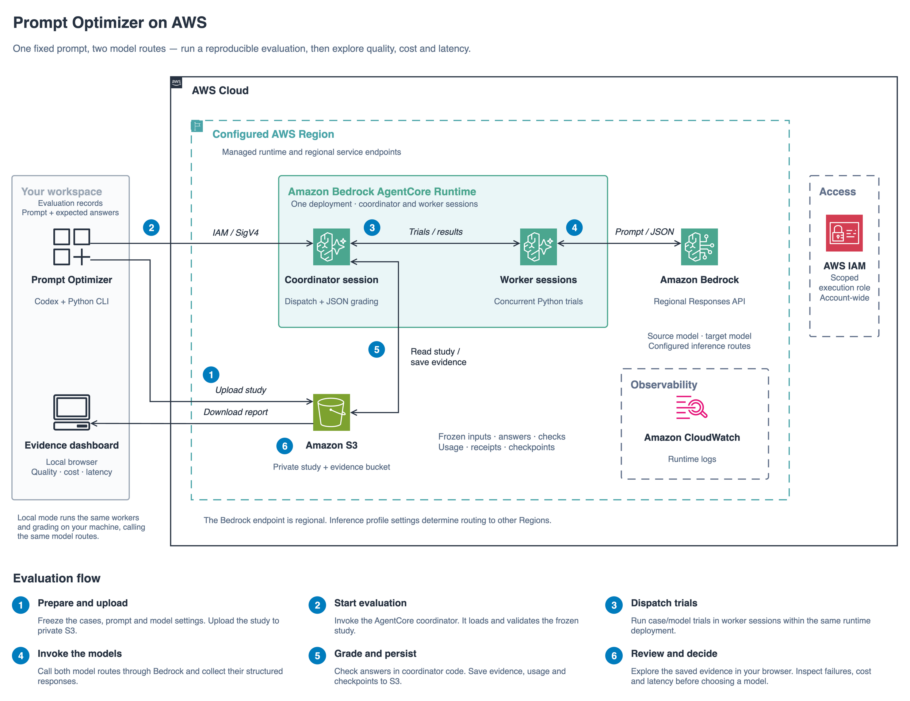

# Prompt Optimizer

**Compare models** with a fixed prompt, or **optimize a prompt** using development feedback and held-out evaluation. Then
inspect quality, model cost and latency in an HTML dashboard. Start with
invoice-text extraction, support-ticket triage or a complex support-case decision. Run the evaluator on your laptop
or in Amazon Bedrock AgentCore using the same prepared study.

Codex guides the setup and asks what the evidence needs to prove. You choose
which errors matter, what a correct answer looks like and whether the result
justifies a model change.

Have source text but no expected answers? The [source-based judging workflow](skills/evaluate-workflows/references/source-judging.md)
uses a separately selected model and an agreed rubric to assess extraction
outputs against their sources. It reports source-assessed quality, not
human-verified accuracy. It does not create reference answers from past outputs.

Have reference facts for amounts or decisions, but want an LLM to review explanations too?
Use [reference checks with separate source judgments](skills/evaluate-workflows/references/reference-and-source.md).
Required deterministic checks determine correctness and cost per successful result;
optional LLM assessments stay visible separately. For model migration, results show
the original prompt on the source model, the same prompt on the target model, and
the revised prompt on the target. Optimizer and judge calls are separate roles.

For longer inputs, the [complex support-case example](examples/complex-support-resolution/README.md)
includes contracts, invoice lines and incident histories, with named decision and
evidence checks. The same plugin supports configurable request/output limits and
provider timeouts. See [complex text studies](skills/evaluate-workflows/references/complex-text.md)
for setup and grading scope.



**One reusable evaluation workflow.** Prepare your inputs and starting prompt,
run the study locally or on AgentCore, then explore the saved evidence in a
browser. The cloud path above applies to any supported structured-output
workflow. [Open the editable AWS diagram and six numbered steps](docs/prompt-optimizer-architecture.md).

Follow these six steps:

1. [Install and verify the plugin](#1-install-in-codex), then open a new session.
2. [Choose a starter](#2-choose-a-starter), or bring your own evaluation records.
3. [Agree what the study should measure](#3-agree-what-the-study-should-measure).
4. [Choose local, AgentCore, or both](#4-choose-local-agentcore-or-both).
5. [Review the preview, then run](#5-review-the-preview-then-run).
6. [Inspect the evidence and decide](#6-inspect-the-evidence-and-decide-what-to-do-next).

For a first look without model calls, complete steps 1–2 using the recorded
demo, then go straight to step 6. Fresh studies use all six steps.

| Start here | What you get | What you need |
| --- | --- | --- |
| **Explore the invoice demo** | Interactive results from a recorded local and AgentCore run, plus an AWS architecture diagram | Python; no credentials or new model calls |
| **Prepare a starter** | Inputs, expected answers, a request preview and a reproducible study plan | Python 3.12 and plugin dependencies; no live AWS calls during preparation |
| **Run locally** | Fresh model answers and a decision dashboard | Model access, verified prices and authorization for model calls; no AgentCore deployment |
| **Run on AgentCore** | Cloud coordinator and workers, durable artifacts and a downloaded dashboard | Model access plus a matching AgentCore runtime, IAM role and private S3 bucket |

## 1. Install in Codex

### 1.1. Choose the integration branch

These instructions use `codex/prompt-optimizer-integration-20261124` in
`openai-on-aws/benchmarks-openai`. The marketplace is named **`openai-on-aws`**.
This branch includes the integration changes; `main` and the earlier
`feature/customer-eval-plugin` branch may contain different versions.

First check existing registrations:

```bash
codex plugin marketplace list --json
```

If `openai-on-aws` is not registered, add this branch:

```bash
codex plugin marketplace add openai-on-aws/benchmarks-openai --ref codex/prompt-optimizer-integration-20261124
```

If it already points to this repository and branch, refresh it:

```bash
codex plugin marketplace upgrade openai-on-aws
```

An upgrade refreshes the registered source; it does not switch branches.
If the name already points somewhere else, review that registration before
changing it. The same marketplace also supplies Bedrock Bench, so replacing
its source changes the catalog used for both plugins.

<details>
<summary>Switch an existing registration to this branch</summary>

Use these commands only after deciding to replace the current `openai-on-aws`
source. Record its current URL or local path and Git ref first so you can restore
it later. Removing a registration does not remove your workspace studies.

```bash
codex plugin marketplace remove openai-on-aws
codex plugin marketplace add openai-on-aws/benchmarks-openai --ref codex/prompt-optimizer-integration-20261124
```

Then install and verify the plugin in step 1.2. A marketplace refresh alone does
not establish which plugin version is installed.

</details>

<details>
<summary>Use a local clone of this branch instead</summary>

```bash
git clone --branch codex/prompt-optimizer-integration-20261124 https://github.com/openai-on-aws/benchmarks-openai.git
codex plugin marketplace add /absolute/path/to/benchmarks-openai
```

Replace the path with the clone you just created. Its root contains
`.agents/plugins/marketplace.json`, which also declares the name `openai-on-aws`.
The local clone and Git registration are alternative sources for that same name;
do not try to register both. If the name is already registered, review it and
follow the source-switch guidance above, using the local path in the add command.
For later updates, update the clone before reinstalling the plugin.

To inspect the workflow without changing any registration, ask Codex to use the
clone's `plugins/prompt-optimizer/skills/evaluate-workflows/SKILL.md` directly.

</details>

### 1.2. Install and verify the plugin

```bash
codex plugin add prompt-optimizer@openai-on-aws
codex plugin list --marketplace openai-on-aws --json
```

Check that `prompt-optimizer@openai-on-aws` has `installed: true` and
`enabled: true`. A marketplace registration by itself does not install the plugin.
The user-facing skill is `evaluate-workflows`; `engine/intake/` contains
compatibility instructions for older callers.

Earlier review ZIPs registered a separate marketplace named
`customer-eval-integration`. Their `prompt-optimizer@customer-eval-integration`
installation is a separate copy and is not updated by these commands. Use
`prompt-optimizer@openai-on-aws` for this branch, and verify it before deciding
whether to remove an older copy. An old ZIP does not receive later Git changes.

### 1.3. Open a new session

Open a **new** Codex app chat in your workspace and choose **Evaluate Workflows**
or invoke `$evaluate-workflows`. You can also start the CLI:

```bash
mkdir -p ~/prompt-optimizer-work
codex -C ~/prompt-optimizer-work
```

The [numbered new-session quickstart](docs/QUICKSTART.md) includes copyable
prompts and a terminal-only demo. This repository marketplace is separate from
the universal plugin directory; the branch-specific commands above select the
version documented here.

<details>
<summary>Updating a preview installed under the former name</summary>

After verifying the marketplace source in step 1.1, install
`prompt-optimizer@openai-on-aws` as shown in step 1.2. Once Prompt Optimizer works
in a new chat, you can remove the old cached preview with
`codex plugin remove customer-eval@openai-on-aws`. Your study directories and
reports remain in your workspace, outside the plugin cache.

</details>

## 2. Choose a starter

| Use case | Example decision | Included material |
| --- | --- | --- |
| **[Invoice extraction](examples/recorded-invoice-comparison/)** | Can a different model extract invoice fields at acceptable quality, cost and latency? | Recorded interactive comparison, per-case answers, cost/latency charts, AWS diagram; reusable OCR-text logs in `engine/examples/log-replay/logs/` |
| **[Support-ticket triage](examples/support-ticket-triage/)** | Can a model assign the right category, priority, queue and human-review flag? | 60 synthetic tickets, a fixed triage policy, expected JSON answers and a decision template; no recorded live results |

For the quickest first look, ask Codex:

> Use Prompt Optimizer to open the recorded invoice comparison and AWS diagram.
> Explain what the results establish, and ask me which errors would matter in
> my own workflow.

To prepare the new example, ask:

> Use Prompt Optimizer to start the support-ticket triage example. Show me the
> policy and ambiguous cases, and help me challenge the expected answers.
> Prepare a local study first; stop before paid model calls.

Both starters use the same skill and entrypoint. The triage example evaluates
routing **decisions**; it does not create tickets or call a support platform.
The invoice example starts with OCR **text**; it does not extract text from PDFs.

## 3. Agree what the study should measure

The skill inspects your records, explains exclusions and preserves the chosen
prompt. It asks for decisions in small steps:

- Which two model routes should be compared, and who owns the study?
- Which fields determine success? Should a wrong priority count differently
  from an unnecessary human review?
- Do you have expected answers, or should a judge assess outputs against source
  text? If answers exist, are they independently reviewed, synthetic, or historical
  model outputs? What evidence would change your mind about them?
- How many distinct cases and repetitions are useful? What cost and latency
  tradeoffs would justify switching models?

The default keeps the prompt fixed and needs two application model selections.
It does not require an optimizer. Source-based judging adds a separate judge
selection; prompt optimization adds an optimizer selection. You can use the same
application model before and after prompt optimization. Synthetic labels remain marked unreviewed;
matching them is not proof of production accuracy.

## 4. Choose local, AgentCore, or both

**The workflow asks about infrastructure only if you choose AgentCore.** Before
freezing the study, it establishes whether you already have a matching runtime
and bucket, or want help creating them in your chosen AWS account and Region.

| Resource | Purpose | When needed |
| --- | --- | --- |
| Amazon Bedrock model access and credential references | Invoke the selected models | Fresh local and cloud runs using Bedrock |
| AgentCore Runtime | Host the coordinator and worker sessions | Cloud runs |
| Scoped IAM execution role | Give the runtime access to models, artifacts and worker invocation | Cloud runs |
| Private S3 artifact bucket | Store frozen inputs, checkpoints and reports | Cloud runs |
| CloudWatch Logs | Inspect runtime execution logs | Cloud runs |

Installing the plugin, opening a demo and preparing a draft do **not** deploy
resources. The `run` command also does not provision missing infrastructure.
The skill guides the separate [AgentCore setup](docs/LIVE-SETUP.md) when needed,
using your existing authorization or obtaining it for the concrete deployment.
Model calls and infrastructure have separate charges.

A matching deployment can be reused across both starters and later studies;
you do not need a new runtime for each run. An engine update requires a matching
runtime update. Cloud references must be set **before `prepare`**. If you later
add AgentCore to an already frozen local study, create a new study revision.

## 5. Review the preview, then run

### 5.1. Prepare the study

For fresh studies, Codex creates a Python 3.12 environment and project in your
workspace, outside the installed plugin cache. It uses a copy of the
[connection template](connection.template.json) for model IDs, endpoints, AWS
profile references and verified prices, including their source, verification
date and priced context bound. Never place credential values in it.

### 5.2. Review the frozen plan

Review `input-preview.html`, the expected answers or agreed source rubric, and the plan's case counts,
repetitions and budget before paid execution. Resolve any input, model or
deployment changes in a new study revision before proceeding.

### 5.3. Run the chosen backend

Use your existing authorization or authorize the reviewed live run.
`run --backend local --live` runs local workers;
`run --backend agentcore --live` uses your deployed runtime. AgentCore also
makes two model calls to qualify the source and target routes.

The [support-ticket guide](examples/support-ticket-triage/README.md) provides
copyable preparation and execution commands. The
[workflow reference](skills/evaluate-workflows/references/workflow.md) covers
custom invoice logs, connection settings and the common commands:
`start`, `inspect`, `configure`, `prepare`, `plan`, `run`, `status`, `results`
and `dashboard`.

## 6. Inspect the evidence and decide what to do next

### 6.1. Retrieve the existing results

Open the returned `decision.html` for quality checks, per-case failures, model
cost, timing and prompt evidence. Each backend produces its own report:

- Local: `<project>/local/decision.html` and `report.json`.
- AgentCore: `<project>/results/decision.html` and `report.json` after retrieval.

`status` and `results` inspect the existing job; they do not submit another
study. Add `--backend local` to inspect local evidence.

### 6.2. Build and open the dashboard

Build an interactive dashboard from either backend, or compare both after
retrieving their results into the same project:

```bash
python3 /absolute/plugin/scripts/workflow_eval.py dashboard \
  --project /absolute/workspace/my-study \
  --output /absolute/workspace/my-study/dashboard.html
```

Open the returned HTML file directly in a browser. It has three views:

- **Overview:** backend filters, quality checks, cost/latency tradeoffs and
  the exact comparison table.
- **Test cases:** search inputs and outputs by case, filter check failures,
  inspect answers and request receipts, and export filtered evidence.
- **Run details:** completion, unresolved attempts, price coverage,
  fingerprints and the saved prompts.

To see the current interface, follow the
[recorded demo instructions](#try-the-recorded-dashboard-from-a-terminal).
Opening the demo makes no new model or AWS calls.

Day and night views combine OpenAI-inspired monochrome surfaces, AWS orange
and Squid Ink accents, and embedded Open Sans from AWS's Cloudscape design
system. Headings use OpenAI Sans if it is installed locally; Open Sans is the
offline fallback. [Typography sources and font licences](scripts/fonts/README.md).

The dashboard renders saved `report.json`
data in the browser, works offline and needs only Python's standard library
to build. It reads a single report directory, or the `local/`, `agentcore/`
and `results/` report locations within a project. Combined reports must have
matching input fingerprints and one report per backend.

The results summary compares source and target with the original prompt, and
compares the original and selected prompts on the target model when both were
evaluated. Each backend gets its own summary with pass counts, the selected cost
measure and observed p95 changes. Improvements, regressions, tradeoffs and missing
evidence are reported separately. Switching the cost measure updates the summary
and chart; it never changes the saved prompt selection. Reference provenance is
kept under Run details, with a short data label and link on Overview. Measured
differences are not significance claims.

When a prompt revision has matching cases and verified evaluation criteria,
Overview starts with a compact before/after comparison: required-check pass rate,
output tokens including reasoning, p95 time, cost per attempt and cost per
successful result. Both costs stay visible so fewer failed answers cannot hide
an increase in cost per attempt. A criterion table shows failures and unknown
checks separately, including optional checks.

The paired example shows the same input and expected answer beside both model
responses and their checks. Where an improvement is available, the initial example
illustrates the required check with the largest reduction in failures; the page
explains how the example was chosen. A selector
includes every matched case and repeat, including regressions. The full prompt
diff and prompt links show the wording change without claiming that one edit
caused a particular result. All of this reads saved evidence and leaves prompt
selection unchanged. Missing criteria or unmatched attempts are reported as
unavailable rather than reconstructed.

“Starting prompt” is the prompt supplied before optimization. “Revised prompt” is
the version the optimizer chose after testing its candidates. Summary tables name
both prompts or models in their column headers. “Saved run results” means the page
reads report files; it does not update live or start model calls.

Click **Starting prompt** or **Revised prompt** in the Overview comparison to
read its full text in **Run details**. Each prompt card identifies its model and
execution location and has a **Back to Overview** button. Runs that kept the
starting prompt do not label it as revised.

Chart points name the model and prompt. Each execution location has a separate
plot with shared axes. The vertical axis is estimated model inference USD per
1,000 attempts or successful results, according to the cost selector. Tooltips
show both the per-result and per-1,000 amounts. These are normalized model costs,
not total run spend or AgentCore pricing. AgentCore Runtime, Gateway, storage,
logging, other infrastructure and human review charges are excluded.

This is an interactive snapshot, not a live AWS monitoring service. Run
`results` to retrieve cloud evidence, then rebuild with `--force` to refresh
an existing dashboard. Rendering makes no AWS or model calls. The HTML and
exports contain recorded inputs and outputs; share them as evaluation data.

### 6.3. Decide what the evidence supports

For source-based judging, inspect pass, fail and needs-review counts and the
cited source passages. `needs_review` does not count as a successful result.
Judge/model errors are reported separately from extraction failures. Compare
application inference costs and latency, then inspect the additional judge and
optimizer spend; a slower judge does not make the extraction model itself slower.

A useful conclusion may be that the data is too easy or the labels need review.
Do not choose a winner just because one chart looks better. Repetitions are
not additional independent customer cases; sequential local/cloud runs do not
isolate hosting overhead. Missing usage stays unknown, and reported model
cost excludes infrastructure and human review.

## Try the recorded dashboard from a terminal

This is an alternative to using Codex's installed skill. Follow these three
steps; none makes model or AWS calls.

### T1. Get the repository

```bash
git clone --branch codex/prompt-optimizer-integration-20261124 https://github.com/openai-on-aws/benchmarks-openai.git
cd benchmarks-openai
```

### T2. Copy the recorded demo

```bash
python3 plugins/prompt-optimizer/scripts/workflow_eval.py demo --output invoice-demo
```

### T3. Open and review the dashboard

Open `invoice-demo/dashboard.html` for the interactive results workspace.
The original `invoice-demo/index.html` remains available with its detailed
historical narrative and AWS diagram. The demo uses only Python's standard
library and makes no AWS or model calls.

These are the **recorded 13 November 2026 live measurements**: 96 evaluation
trials and two route checks per backend, with a combined estimated model cost
of $0.71, excluding infrastructure. Both models matched every synthetic,
unreviewed reference. That leaves substantial uncertainty about quality on
harder, real invoices. See the [recorded evidence](examples/recorded-invoice-comparison/).

## Development and scope

```text
prompt-optimizer/
├── plugin.json                 Portable plugin identity
├── .codex-plugin/plugin.json   Codex presentation and skill discovery
├── skills/evaluate-workflows/   One shared workflow (stable skill identifier)
├── scripts/workflow_eval.py     One entrypoint for both starters and backends
├── engine/                    Bundled evaluator and AWS runtime
├── examples/                  Recorded invoice report and triage starter
├── docs/                      Deployment and editable AWS architecture
└── tests/                     Installed-package and workflow checks
```

Live workflows support Python 3.12 on macOS or Linux. The bundled engine retains
broader Codex, Strands, Gateway and optimization capabilities for compatibility;
these are not required by the two public starters.

Install `requirements-test.txt` in an isolated environment, then run from the
repository root:

```bash
python -m unittest discover -s plugins/prompt-optimizer/tests -v
python -m pytest -q plugins/prompt-optimizer/engine/tests \
  plugins/prompt-optimizer/engine/intake/tests
```

Tests use local fixtures and loopback protocol servers, without live model
calls or AWS deployments. Package tests copy the plugin into an isolated cache
and invoke it from another directory.

The plugin is [MIT-0](LICENSE), with an included MIT-0 importer.
[Upstream provenance](UPSTREAM.md) records the source and integration changes.

## Integration branch

The `codex/prompt-optimizer-integration-20261124` branch integrates Nick’s plugin
with the workshop engine and subsequent fixes. The evaluator is bundled at
`plugins/prompt-optimizer/engine`, so the installed plugin does not need the
original workshop checkout. Use the `evaluate-workflows` skill and
`scripts/workflow_eval.py` entrypoint.

Choose `start --mode compare` or `start --mode optimize`; see the
[optimization walkthrough](skills/evaluate-workflows/references/optimization.md).
The dashboard shows both cost per attempt and cost per successful result. Small
comparisons use all selected cases across validation and holdout; prompt optimization
keeps a development split and its validation minimum.

Use [the branch installation steps](#1-install-in-codex) above,
then open a new Codex chat.
