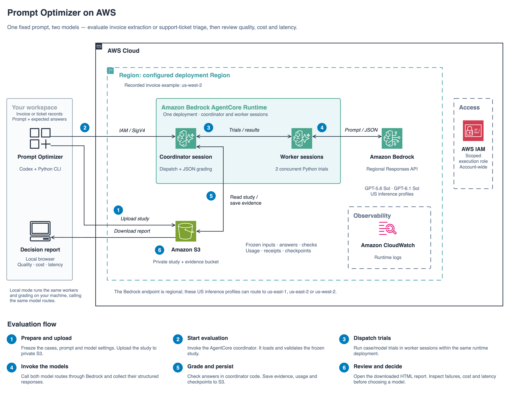

# Prompt Optimizer on AWS

[Open the editable diagram in draw.io](https://app.diagrams.net/#create=%7B%22type%22%3A%20%22xml%22%2C%20%22compressed%22%3A%20true%2C%20%22data%22%3A%20%227V1bc5u6Fv41fnSGu%2FGjL3F3z7SnOU17uvdTRgbFZoIRR5LjpL%2F%2B6MJVQOMkDuCETicDQmAun9a3tG4amYuRuXrYhSNDu4eYBCgamcuRMdEvNPaXtcLIQ34QbWTznt6OXX7AXI3My5E2G5mL3cNtEELWdYsIFd2MyxB6FLNrGYZyYcOYXjgXOj8gzzc0%2Ft9c%2BAHYYLBjOxHYQdn3CqNdTFnTt5gGu%2BA3xGybX1Wb%2FbqW1w582TUWXcco7TgGB6L%2BSPpTu4dPGMTbr8iH%2FLn9h%2BTONE2TF%2FUfZYtu60nLBqc%2FlDbsAx%2BSpJtsisEGlvrwhl%2BBT7fq9fmBv2Cw2VL1d3Yg7Z00kC3w0aHQVH2g9LEwQrTxcP7sCxiGhReX%2FM7IWD3%2F3OzBMYzo6y9HA8pxJCADwv3xICD0MUx636KIrsAuCPkn%2FAuG95AGHhiZcwof2C3Ot5Rh3VzqbPOwDSi8joHHTz0wRLA2wlB7BxcoRJg1Rihix%2BYM3qHSBMJgwwEdwlt%2BVYZw%2FjPhLGneBb4filPZ7Vyze2ZtppXuJ3erJ%2FvppUMOiLEP8N3IYGPMNCamYbFXvGDbl8uVuWLDccrOyQYVe6TG76D%2FCSuV4QDRDlL8yPZBgulN1sSvnPyOacvdZHjwbb57yDGuu9MEAdsCvu1noIL1SYDxbPyQ%2FboeQt8iLp5ugwfo89eUAIr9lEYPiI86LgkIv%2BqlMXK10dTigo9fAFB%2BZhDdo8DjWwxEGHg0EPhDHIlkH8cI0zH7%2FneQw5TigAsCefkt5B0xvA%2FggW38b8%2BAQx%2FlQY%2BLS%2FbGI35TIfulyHu8OCNAG7oCaO0JQNuuM3ctCej5YjFfLnoGaPdYQFtGK4BmHDb2QrT3K4gWok9b5MeOQQxG%2B8iHfoIWgL30Qz4XRrlwSo%2BkNGdc2Aq%2BVBCsxD8JAn3KZMhKgoCfkwIJ7CmqASFFcRWphN0oU0%2B%2BiL2l7uZNP3j3pW4pqDWfEMPFh%2FNYOwgiiJN%2BMQoiCvHlPYMlSRDvoTAEMQnW2RhgnB3z7d3DhusZF%2BwzWhcb9vb57W%2FwZ0%2FoQtWjN2zzRnzvGxBWn82y1GfrePC4Wmn06I5dHT62WzN8dM1ohxEw3ASZFpqPnu%2By2ZwJKRzdBps9FtTgwzhEjzv%2B3gzte%2BHktoeXNZ1ZM%2FedDq%2Fs4YrDSzt6ePmAbLPXzHeuAGVn8ZvmExb7NSMwAcwJh15Jhp96CFpl%2FprWDEBTqxmArmG3OP7G8AHs4hq97Dv0EPbFyCuqWLKzGJ17Mj5AQsfGGelFYpC0phe9Kb50XRHx1qSKMAaxKsLMdjQkvI%2FYpLCKrNkO%2FBY6%2Bhz6GHl3fLa4gfwTYI6x78XTWpft85njrl4g2y9nK4dPAoVsd82FpfVQtqcP9zLVqXvIVya5elWoTtK2EuJNrU3Ij5%2BY7ZZUmdHCGM0nQtthAjeIABVzVzn1PCB8J4wqBBJupyODrG0AXkHanBx2ZdRZVdA5TndiFsWkCrM1gfgerANp0ehCkjr6RHNn71RLzh7uZZL0CC25e2E7VaaQjlnFvWnU4N6w2hG2wPOYUKyqF4XmAfQD6J%2BnVJtT7UkVQ7frpH1LhnSuERABQxX4%2F6A9TlSGQoe2h8B0PpvM7ZcMgdlqvlrIIWBoxpzDoW9DIHu4N9Sg2zCmZ%2BbBAqoNu0ZxnmjtGCOCKN7Tqiz%2FnFkehE6c%2BXGwME6w%2Fo6wxa7ZQWfDtzKH5MiYC3tFDD0qjBggIgeIO9efPchxcqwGPWlTgy4JjpML1slTOrRhdOed9MJATMYU%2BB0PlnqjJmQCIvBuQByHrBuV1kvWwQ9g%2Fg1rMFP14SidCRsG3jYBBNrTkImiBYoiBvaksQBbQGLZLp2sOfS%2BgDUMrxAJ5J0t14hStHtSvmYQ7h5VClnrNWRd5%2BNw20TV%2BPjQiTMSTRUH85tGTOTj89QIGk%2FsizKIplVHs1FrRXXbBJEPmb4RVlC0QD57bSndXT3SrbCsLr58Pi%2Bia9VU1CaadMM9Dk5OOzKJT7zWCGD%2F1GSXvNSB396Q36xJr%2Fgtw1IDxS2hFxAZjoUhD8QaGK4RRqVx%2BeFILkdSA899QexrsaY1RgfCVSV14vefNHqv6E8hJf9KEsY3EGNfQNg3biw54E7LjhgStMcelNEtc7ZbF%2Beylg7xG8Dd4R53h1d4U3FQF44kJuSzIs83dNpN7F5PDXOoNZDnouQNTty%2FA4E2K%2FXlwXty6aVr2hEc6nY4USxAqoFFlwHTVLlsSCeM%2F7r%2B9m%2BRQQNEGtHAjP1BVy05ut2Ro4xEIQMxnjsx2kavmTHBWQMr%2FupbPFSPGbEwYk8ur6bHTCgn3ZFhiqIGIjRkcoG3x1gG4WWWU54hFpKBCfuBqloSnHRHgus0YrlDEnzv1PfGQfNK1HwWGdwP9ku%2BcQP7VSPnB%2FJrQFFhpJ5cTLnHkJ%2FdHfmlIGogP5k7J8yp3yGJmRIFeX717GrwGfYET7W0Z3dHe2kOvgKkT1c%2FxvaFwxqvUVi0tPMDopCIPKDa6n9ei6SyW8herwjuijHiZUoGtaurUG%2FFz2hb5nGh3k47KQ7E7EbjImZV2ZosZzw6e1C2jgg6VXQtZ9orXYuYT6lZ1%2BagYTVCRw7K01tCzSO0K7ND7YrBpkGxusLBvSxKQ%2Bjef8yjkO8DP2G69V5GMA881zWq6nQss0MdK0QbcvqYLCbZD9zjcyMuf2xw1uVEtyfzdxCcleRGntyKYCj6UpXXHLcGSW5rSHqK2UR1ol%2FSFzgwXAN60iH5Bt4%2BXZFGdfk4HZrPBYSazAepa0rLRdZAZd3CR9edXtnJA14stIsZG1e0mOh7vAGRfyMThG92IAIbuJPRyQrTLU1zaRvvZjaXpT6%2FdTG%2BXrmMGdqa%2BE6U4vs8%2BzqwXCNokrF6cill8pTfJ%2BZxumV3xnEcNQ0Ud%2B2hWCSNwgfo7ZOKohhxgKm2zJnnIUaIY%2FZQcODC7kFWN62rRVlLTEgowrAJZyuMfositGn6c25Cz9KVC%2FHsW%2Bjd1eQ8%2FySipm3eEUMPBjGtniyy1M%2BqhND03djYbaWcysSxemV%2FIBRkCTpC0apmRrMeG0gbYuWhn1ZYb6ppcBzm%2BHXSr40w3aIN91Ve5q2FahWK8lUG4rEkqdap4DZ%2FGPkzjEVtd8YEkWxJManJ3VXAX7O4B%2FgQ0L%2BTm%2BDb%2F%2FD2C0v0Yzj4O%2B3Gd%2FJjJ0UZhiGgwX35E7QBmXHINdtq5Qauc4kbMLTrYPNfq3EEelKXButQrdBfsAoWwHkkhoTCrSjnL%2BJJVQQZL1TGxHuaA%2B9uIwCsCMe3B0Py1rULs1zg5miDa34DV5xHCr%2BObm9JatV%2BGnMl5GXP8oY43cchAv7xsi11Nw4iTRVprv0HmWa0AOPn4JQ9LihePNd%2Bjr9KFfPphFiZEduO%2BTz8P%2FP67kR%2FyfXFuJEvopeDsoE9fiYjNnWkvYI6SoN%2F4I5XcodT5g773XOHn6VMVdhD1YCLFFLKlvnIPCI0N%2BUE0VY8RTQM%2BnSKtQah%2BCNJTUi0agzJPsxqpr1MOCroHsTj68TjRxOOhRhOVTqWBGBRMpZSKAbJOEjGZwGtQTQWyj6usrTmV8hFFdiDYHyl3mh9NNGYx%2Fw9S28cTA8nFYzTomDUy4LR%2FkjmCneimismJzVXqNd3p%2Fb7Mlek47mBgL7DorlC0pDqpyPgHpaigd%2BvG65%2Fy6NONcX9Zh2Zs5e66d567ocOUb2VOqWEIk0oVRwHQ3W%2BnRiq%2FyD43XdhK0jw0iCPlhmcSqUXX2omKINz0IZfpQ2PVRfc%2BAPow7chOowJhfFYr4BVf35oKLt4EBNYRtefVpfQtMlivkwWWHHc2aJ5fbZ6Ii0vBJFFh9aF6RXD%2BI5HfHfcaNkKN9asVWk6NYF6TiuiLoeOUVfIZYBOl%2BuKGE9XKO4FdKoZxOYAnU6h42pnAh2rAh1rgE6n0NGzJeb6jh27gh17wE63YkdXDQFaP6HjVKDjDNDpFDqOAp2p3SvohLxG%2FpjX6mksny8PanjPC2dqdCtqFQCRzJk5bJOVh7OawJrIfnmUiwvugLcN%2BBrGC246AAxdokvpSqJakEiY2VNILs7JztnqemtvNJdTEkO16qrw2bIipZX%2B2rFzYlF8bBwhWkXpD4GifFV4GPlxYuUIiDCqJIXL%2BAvmmCO8%2Fx%2BqSTGERikQ%2BRmI%2FdmTMQSEjqV9KNs10jUGWcMB8oaLYantLvJkJoqMrSlFpWfpqEUAWy3VomLc3FRe4ZJvgyRfkDP5GUGIaRctJp22schpDpMidty6ROWWVqwO4YbJtMEM2lNblgqfOjOo211NDgkeIXlq0HOFIX9Dmf723Lj37gWQfvYCyJ2qCKo6me26ZZZNq00IrZH%2FWIOgFYbwN8y0eQ%2BIurALqVHJ8DoJrVTBJ5BSpv9zFV%2FLMjaSqUASCCFUrjiri3ZtDlpVp4g0a9LjaxFpT1tnxMG70zuDh6udDyVW4XMts4Y1WFDLBzpsDz4T0zofPqzC53N0zz5uRmmzjaibKFSsQgwvJ7%2FPVFRDA35uPmPXCXxGermd7TYt9iG4ceDBbqHYZyIcfNW9cziaxhlNDs0%2FLfzXjwWOPhYR6ubkjGaGZl3Jz2RCyH8imf2lQNKCKHMflRZmY89Gt%2BJgyT2ULW2n%2BZBNGh95YcaBDTvGY5%2FpcIi%2F6bul1NL6S4bWU3p9cXGbgRC7MUtZWn%2FpsAqgBRCd14huK%2BEOAlZsc7MtubLlpNBDYcjLAwvoBYItKd57dI%2BhzNRIVuMa6LBbNJr9JcMhoLD3RtI%2Bs2EVPp8w8HOvYQwxCQgd2LBT41Sf6bCKoAUvLVwqWSwmfaU6B2zPh9xUeq0mQcsgLFnBOGHJYqli6UEc%2FIadQ7LHnDhESvffXtpnUnRqyjncB%2FCQSSQfej0o7%2F%2FRbaZ9ZsUqhL7FMDd9pgn0Ypr314%2BvX7K8fOE%2BjOSqMYZ2C4KQTQaTsBsPkTzoJgSUESZ%2FbWt4m3ghtwgRGYAP0onowJNdo7QbohR9MEK0pkea5s%2BXSfoqrBXFPuKoH4ANBrvkQHICj6JnLf8H%22%7D) ·
[Open the full-size image](invoice-evaluation-flow.drawio.png).
The PNG embeds the complete editable draw.io source.

The layout uses official AWS icons, an AWS Cloud boundary, a dashed Region
boundary and a group for one AgentCore Runtime deployment. It covers invoice
extraction and support-ticket triage through the same workflow. The recorded
invoice deployment used `us-west-2`; new studies use their configured Region.

1. **Prepare and upload.** Freeze the cases, prompt and model settings, then
   upload the prepared study to the private S3 bucket.
2. **Start evaluation.** The shared Python entrypoint invokes the AgentCore
   coordinator with IAM / SigV4. The coordinator loads and validates the study.
3. **Dispatch trials.** Coordinator and worker sessions share one runtime
   deployment. The example uses two concurrent workers running Python trials.
4. **Invoke the models.** Workers call the two configured Bedrock model routes.
   The shown GPT-5.6 Sol and GPT-6.1 Sol routes use the Responses API and US
   geographic inference profiles.
5. **Grade and persist.** Custom Python grading runs in the coordinator. S3
   retains answers, checks, usage, independent worker receipts, checkpoints
   and reports. Grading references are excluded from candidate model requests.
6. **Review and decide.** Download the HTML decision report, compare quality,
   model cost and latency, and inspect individual failures before choosing a
   model or extending the study.

IAM provides the scoped execution role; CloudWatch records regional runtime
logs. The diagram places the account-wide IAM role outside the Region boundary.
The Bedrock API endpoint is regional, while the example US inference profiles
can route inference to `us-east-1`, `us-east-2` or `us-west-2`.

The current [deployment helper](../engine/scripts/deploy_agentcore.py) uses
AgentCore `PUBLIC` networking with authenticated invocation. It does not create
a customer VPC, subnet or NAT gateway. Grading is application code rather than
the managed AgentCore Evaluations service.

For local execution, the same workers, fixed prompt and grading run on the
user's machine and call the same model routes. New studies produce a separate
HTML report per backend. Only the [recorded invoice demo](../examples/recorded-invoice-comparison/README.md)
currently combines local and cloud evidence in one dashboard.

The XML structure, AWS icon names, edge references and geometry passed
validation. The exported image was visually checked for label and badge overlap.
