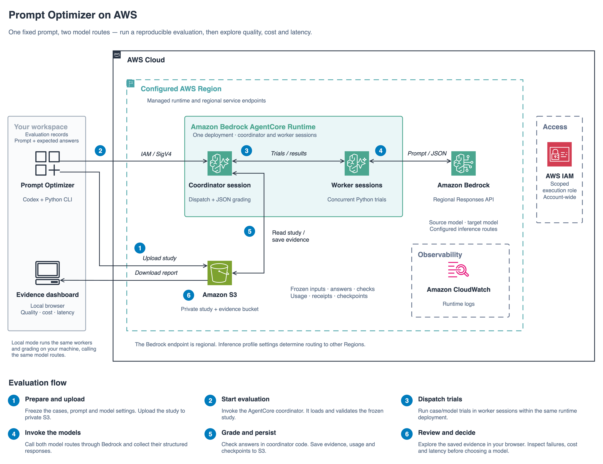

# Prompt Optimizer on AWS

[Open the editable diagram in draw.io](https://app.diagrams.net/#create=%7B%22type%22%3A%20%22xml%22%2C%20%22compressed%22%3A%20true%2C%20%22data%22%3A%20%227Z1bc6M4Fsc%2FjR%2Bd4mrwoy%2FxTG9172Q7M9szTykZZJsKRqyQ46Q%2F%2FerGTUDHSRzACV2pLlsImctP5390dBuZi5G5etyHI0N7gDgJUDQylyPD0a80%2Bj9NhZGH%2FCDaiuQD2YxddsBcjczrkTYbmYv94yYIIc26Qwnh2YzrEHoE07IMQynYMKZXkyudHRDnGxr7Mxd%2BALYY7OmXCOyhyHuD0T4mNOmPmAT74CfE9DMrVZv9uBVlB77IGvOsY5RmHINjov5I%2BlP7x98wiHffkA%2FZffuP8so0TROF%2Bk8iRbd1mbLF6Q%2BlCYfAh4nMJpJisIWlPCzhR%2BCTnVo%2BO%2FA7DLY7ov7OHqS5ZUKyAz46FpKqN5TeFkaINB7O730Bw7Dw4OTvjIzVy8%2FNbhzDiLy9OBIQxhFHBoSH0yFIyFMoc29QRFZgH4TsFf4OwwdIAg%2BMzDmBj%2FQS5ztCWTeXOv143AUE3sbAY6ceKRE0LaHU3sMFChGmiRGK6LE5xTtUkkAYbBnQIdywUinh7GfCmUzeB74f8lPp5dzSa6ZpppV%2Bl1ery%2B9p0SEDYuwDfD8yaB0zDcc0LPqIF%2FTz9XJlrmh1nNJzskpFb6nxPei%2FYqVSHSDaQ4Kf6Hcgmd5mSaxk%2BTumLb7K6sE%2Bs6%2FHnHHdnUoCdgW%2B7RdQQfNIMF7MT3JY1yP0R8TM0yZ4hD57TBIo%2BlMaOSJW66QlwOhAaKWmpV8bI1cbTS2WeGCsAfYJ0lP9gxesubmD7BcAYZZNlLWDLCd8jOn7ZBn%2Bd6CYkCdx1GPGkZYTsUsIAaF29enqgvA1dAVf7Rl8bXcydy2B73yxmC8XPcPXPRVfy2gFX6pYYy9EB7%2FCLzd02iI%2FdgoxFObIh76kBWAvfZEvxSg3RemRVNSMK1vhS4Vgxf8JCPQptRgrAQE7JwUJHAiqgZCguEpqQi%2BUOiNf%2Bbel7uZJf7LsS91SqDWfMbrFm%2FNoOggiiGW%2BGAURgfj6gWKZSOI9FIYgTrgJEClUoWP2ef%2B4ZV7FFX2N1tWWPn12%2BVv8xeOeT%2FXoHf14x9%2F3HQir92ZZ6r11XHlcrVR79IldrT62W1N9dM1ox%2F5juA0ynzOvPQsUbYLtAXPjL6rS90LOtuuSNZ1ZM%2FeD1qXs5op1STu5Lvkg2WWPmX25AYSexS6atUXst1Q3SccZ61nJYJ%2B7vlllsZrW1DZTq6ltrmG3WNnGPqSvOazUuW8gom0cX7hP1G2HmesjzgOsqATih8DjrlTkc0CSC3KIeIVpzSF6V9Z0XbHtllOljeJWpc1sxzXKIFIdoz34yZuCc%2Bhj5N0zA7%2BF7BVwB%2Fx78bTW7fx8NnFXr7Dz17PVhLX1uJ13zYWl9dDOpzf3Op%2Bpe%2BQrbVm9amCdNK1EvKm1ifz4mUatD2lr82nPHhotZ2GM5g5vbCLsBxEgCGeG94jwPY%2BdJDBh4bjB1jaBV7A2Z8euTJ1VhW4y6c7MojipYrZmMg3WgQhldGFJJ7qjubMP6jFnN%2Fc6S3qCx9y9sZ0qbceJWeXeNGq4N6x2jC3wPGoUq%2B5FIXmAfoD%2BZU61OdWedTF0u87atxQvZx5BwjFUwf8HHbB0GQoZ2q4C0%2FnMmduvqQKz1Xy1EFXA0Iw5w6FvVSC7uXf0oNuIomdxwQLVhl3jODtaO4GJIIoPpGrLrwu9NRqGHnWQaaYJj7yuKeyTLfuUdTaOjLnoy4Ee4XEMECVHiDt3mj3I4DjVbXbadJtL1uLs1tR5znE2jO56Hr0w4C0whbnTYamPakJqFQLvDsRxSLMREb6kGfwA5u%2Bwhplqj42SObmHxNtJINCBhNT%2BLFAUUdhlYgFbkMQiXXSg5uh9BWsY3qAkEFe2XCNC0P5Zo5oh3D1VikLrNQpd16PhtknV%2BPRhERdkmirdye86GiKvn%2BcmaOzYV2WIptVuZaM2dOq2CVFDnH6BfPrYUrm7eSI7ro%2BLr18uS%2BhajQ%2B1SZNuuKfhNGnHJrHW1hoB7J9b7ORDHfTtHfXNcnqlbxlLDRJ3%2FRD4MOIdhAp2g8jVkFR6Rp9O53KYGqTuK%2FJ4r%2FMao2PCvCW17fefdLhesR8lKfWryHF7gzb2BcK%2ByWOp4%2B28Aolhgg7Yg2KEy5x%2BrRvrshYd4XeAdYN7rBu8Ip1Kx3ThiAwdX5R%2BvmNnnWP3unWYo9agn4tSL7Ds9h0EtNmvL1fes1svXdNO0FC3w7ZiAakGFV0G1FlltiFtM%2F7r9o9%2F8wkygM8SGpSxP3TViqPbnTiKESjJIIyXLoy20WtllJw1qOKPvo2D6rEiFmrs2e3V9JQGpdOdGKYUNUZOI%2B%2BAsRh4lwVOCQ5AmAwq2A%2BiagXQ6U4A1%2Bko5Q4F8KPL3jsPlFdGymejgfuhfPIdNyhfdbT8IHwNFBVq6tnNlHuK8NndCV8KUYPwfc8n8HyHSUwdKD5lenYzdBn2hKda2bO7kz0%2Bvb7a7LvlolWYfp%2BF2QnAW0jyI2qkvjSjM4g2EMtuonQC%2F8BhJ8O8le5G2zJPG%2BY9aWd6Q2J243klZtXpcpYzNjJ7cLpOGHCq%2BFyTaa98rsR8zt26NQdPqxEdUSnPHw01T%2FCyzA69LIpNg4N1g4MHQCAH5uA%2F5YOR8%2BEQ64N3D8mgc91TVedrmR36WiHaJucfmkUt%2B5H1%2Btzx4k8do3Xt6LYz%2FwBjtOS8yLNHEwzFX6rq2sStIcltjaTnlI0vSfRD9AcOCtdAT1ol36HHT1esUd1cnA5D6ByhpjBCti5IbrIGKesWH12f9CpeHrD1QLtosTFHi5q%2BpzsQ%2BXdicvDdni9psxeDlBWlW5rm0jY%2BTGsum%2Fb83ivw9arbmNLWpHd80bAvs2%2BDyjVCI%2Bvq2a2Uyab7PtOO0y27M41j1DRI3K2HYh6ihI%2FQO6RTTxEDTI1ozjwPUUEc05uCgxZ2D1lds66WspaUMCEIwybOVhj95EvPplOf80h6Nmu5MKZ9B737mqnPfyVs%2FepCRgw9GMSkevLlLdU2%2FTAxdltZSsWZWL2KPyQE4DQwJfp3KhOkZe9O%2FXh56KeLqDetZ3Aac6yc9G0jTHZoy%2Fosr%2FPUwkoVivNVBvFUkVTXqGAxfxj5M4z58u1UCSKRkjKpia%2BrgD1mfg3wMSB%2Fy4tgn%2F9h6VcWz0c5%2BDvNxr7kx85KGYYhIMFD%2BRW0gcw4ZJ5txbRxn4tfgKHdBtv%2FWo010BO%2BNFiH6iL8hahgAc4TGeIOt%2BKcv0onVRNkvNIZ489pDrz7LQdYMY7vD4N86tqVWV7c5uSAa34BN0xHCr%2BONpskjWo%2Fz1yJvOxe3pHTQxwi4J9u29LuxsGkqSbNtX9h04wWMH4Jp%2FR2QbHw3Ps5vZQq82mDWGkR2xPzZfy%2FsHzX0V9TPq834kH0slI2qMdfssamHWlvkI5S5R%2B0443aMSlrh%2F3htcPPpk1V1EP1gIsSUpox85l1hHtuygk8rXgKTxj86ZS1BqP4p5yiIL1qDJNDmK2X9jrjqNA9mMe3mcfPZhwLIzhV61gygEXLWJpKMVjGwTK%2BCLQG01hY%2FXGVTW1%2Bg11UwR4M4xv9RuuzmcZ8zN%2BL%2FMYh9HBWwzgtGka9bBjtzxSucB01XOGcNVyhlu9O7Y8Vrkjrc4MAfYfFcIWQIbWfLgEPsDQa%2BON2w%2FVvB9SppnS%2FWSfO3Uu76d677YeOUX2UOpWEokwoq%2BoNger8swxU%2F8Lwux8iViB5abBHywwntvktSjvPXhsmKMM5eMNv8obHahfc%2BBP4w5sQHccJgfFYr8Cqv3xoKC08iBNYputXO0tomrOYL%2BXmKhN3tmjem61eSMubQGSjQ%2BuG6RWH8Z1OfHfaaNmKNtbsWWlOagbqTVoxdTk6RgUdY0Cn2z1FjOcXKu4FOtUZxOaATqfouNqFoGNV0LEGdDpFR8%2B2l%2Bs7O3aFHXtgp1uzo6uBAK2f6Ewq6EwGdDpFZ6KgM7V7hU7I1skfs5V3GpfQFwfZ1u5sHAHZ8bUKAJ%2FMmXXYyl2Hs3WBNT775UlsLLgH3i5g%2BxcvWOgAULp4llJJ6apAYk2fq0uKc7a67do7teWUiaFadUf4bHeR0i5%2F7cQ5MV%2BEbBwhUqX0T05RviM8jPxYRjmChAdVxAJmV2xOX2HxqBgj%2Bv45gZAQSmTC99emdmTPWeUkSlARA5riivkqaKy8yyL04yw65SjGtGbNKT2bd1ok1Wpp0SkqwknjBjeFPSmZZF8QQtSNaHF2aRs7meaYFNlx62Ykt7QtdQi31HgN8c6eBq1UfOrinW53i28IeLjlqaHnBkP2hDJH7aUD3Ls3QPrFGyB3qhJU7U226%2FZSNq02EVoj%2F6mGoBWG8CfM3HYP8IVgF8KTEuPoBFqpJ5%2B6VczxyqZmSJ9fjnjgjlWcLYB2aw5eVadEmjXz4GuJtKetK%2BLQjdO7yIarXY4kVvG5FdODNVhwywc5bA8fx7QuRw%2Br%2BHyJHujLzSRttuULJHIXqzBYl0cdCF%2F2DPh5nIyWE%2FiAL14tz9%2Bkq3pwbRx0sFsU%2ByyEQ6d073oWTeOCGofmr3b568eORp9LCHXTuaCWoVm3tqdsELKfkK2%2FFCQtiLJ%2BotIubPTeyI4fLPUDZfvYaT6kjcYntgLjoIYd89hnORwG2vQ9Umpp%2FRVD6zm%2FvribzSCI3YSlLK2%2FclgFaAF45jUiu8q4Bo4V%2FbjdlfqsRaPQQ2HI1gHm6AVcLQk%2BeETufITT7bcGOeyWRrO%2FYjiMHOx9kLTPaljF5zcM%2FLzXMIY4CRIyqGGnwak%2By2GVoAVbQ7i0NjFv9JUWNKDffMhCpbfqbGfWv3iQSxVLlSyuSSx6EId%2Bw86R7LEmDkOi%2Bx8v7bMoTmrWbXgI4DGzSD70erCO%2F2ePmfZZFasIXT%2FGoegsTKOfD2LviHzXv6Awgn6N0TGBojcxErvFGNoGBCFtG8pROB5K8jE4ISC0FPYU13AjOyV3CCViPDNI26WDbHYNbTe6yfNghEhNjnR6P9se6RsPXhTz8KN%2BALYY7OUBeQIfTG9e%2Fx8%3D%22%7D) ·
[Open the full-size image](prompt-optimizer-architecture.drawio.png).
The PNG embeds the complete editable draw.io source.

The architecture is independent of the evaluation's use case, model IDs and
AWS Region. One fixed prompt and two configured model routes form a prepared
study; the same workflow handles any supported structured-output evaluation.
Official AWS icons identify the cloud services, with AWS Cloud and Region
boundaries around the deployed path.

1. **Prepare and upload.** Freeze the cases, prompt and model settings, then
   upload the prepared study to the private S3 bucket.
2. **Start evaluation.** The shared Python entrypoint invokes the AgentCore
   coordinator with IAM / SigV4. The coordinator loads and validates the study.
3. **Dispatch trials.** Coordinator and worker sessions share one runtime
   deployment. Workers execute the configured case/model trials concurrently.
4. **Invoke the models.** Workers call the two configured Bedrock model routes
   and collect structured responses. Model IDs and inference profile settings
   belong to the study's connection configuration.
5. **Grade and persist.** Custom Python grading runs in the coordinator. S3
   retains answers, checks, usage, independent worker receipts, checkpoints
   and reports. Grading references are excluded from candidate model requests.
6. **Review and decide.** Explore the saved evidence in a local browser:
   compare quality, model cost and latency, then inspect individual failures
   before choosing a model or extending the study.

IAM provides the scoped execution role; CloudWatch records regional runtime
logs. The diagram places the account-wide IAM role outside the Region boundary.
The Bedrock API endpoint is regional; the configured inference profile
controls whether inference can be routed to other Regions.

The current [deployment helper](../engine/scripts/deploy_agentcore.py) uses
AgentCore `PUBLIC` networking with authenticated invocation. It does not create
a customer VPC, subnet or NAT gateway. Grading is application code rather than
the managed AgentCore Evaluations service.

For local execution, the same workers, fixed prompt and grading run on the
user's machine and call the same model routes. AgentCore, S3 and the runtime
execution role are needed only for cloud execution. The dashboard runs in the
user's browser and reads saved evaluation evidence.

The XML structure, AWS icon names, edge references and geometry passed
validation. The exported image was visually checked for label and badge overlap.
